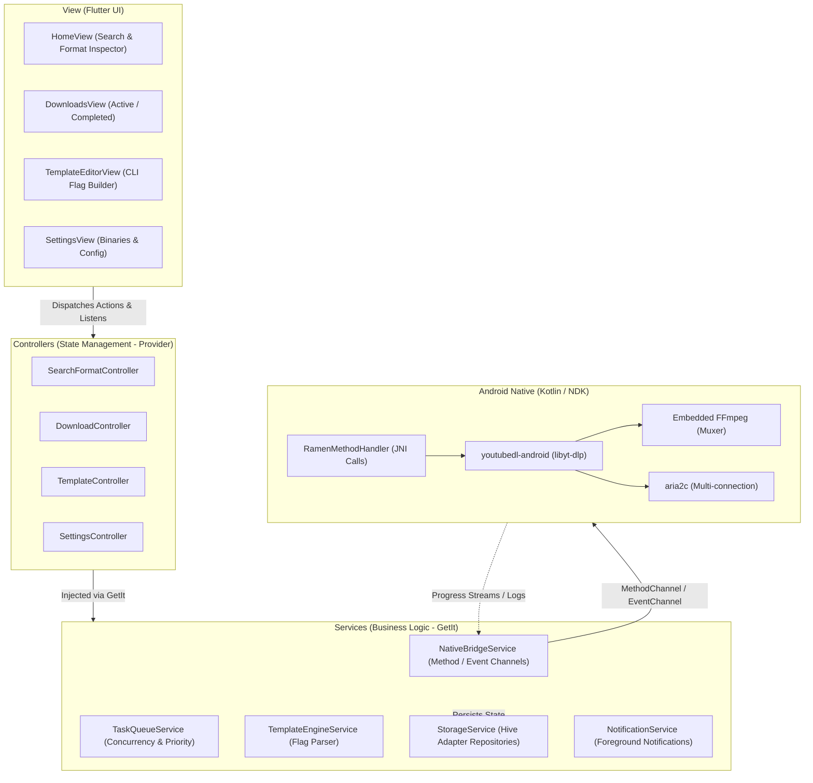

# 🍜 Ramen: Minimalist YouTube & Media Downloader for Android

[](https://flutter.dev)
[](https://android.com)
[-FF0000?logo=youtube&logoColor=white)](https://github.com/yausername/youtubedl-android)
[](https://ffmpeg.org)
[](https://aria2.github.io)
[](LICENSE)

**Ramen** is an ultra-fast, robust, and minimalist YouTube and stream media downloader engineered for Android. Built with **Flutter**, it bridges directly to native Android toolchains powered by **yt-dlp** (`yausername/youtubedl-android`), **embedded FFmpeg** for audio/video muxing and post-processing, and **aria2c** for multi-threaded, high-throughput external downloading.

Ramen embraces an uncompromising **minimalist yet professional aesthetic** driven by a strict **70-30-10 color rule** (70% deep void black, 30% stark functional white and crisp neutrals, and 10% intense crimson red accents).

---

## 📑 Table of Contents

1. [Executive Summary & Core Tech Stack](#-executive-summary--core-tech-stack)
2. [Visual Identity & Design System (70-30-10 Rule)](#-visual-identity--design-system-70-30-10-rule)
3. [Architecture & Schema (MVC + Service Layer)](#-architecture--schema-mvc--service-layer)
4. [Core Features & UI Walkthrough](#-core-features--ui-walkthrough)
   - [1. Format Inspector & Search Experience](#1-format-inspector--search-experience)
   - [2. Command Configuration & Templating Engine](#2-command-configuration--templating-engine)
   - [3. Downloads Hub & Task Monitor](#3-downloads-hub--task-monitor)
   - [4. Settings & Binary Management](#4-settings--binary-management)
5. [Native Android & Engine Integration](#-native-android--engine-integration)
   - [youtubedl-android Wrapper Integration](#youtubedl-android-wrapper-integration)
   - [FFmpeg & aria2c Pipeline](#ffmpeg--aria2c-pipeline)
   - [Platform Channel Specifications](#platform-channel-specifications)
6. [Data Models & Hive Storage Schema](#-data-models--hive-storage-schema)
7. [Dependencies & Pub Packages](#-dependencies--pub-packages)
8. [Project Directory Structure](#-project-directory-structure)
9. [Detailed Implementation Roadmap](#-detailed-implementation-roadmap)
10. [Build, Setup & Development Guide](#-build-setup--development-guide)

---

## ⚡ Executive Summary & Core Tech Stack

Traditional media downloaders on Android are often cluttered with invasive advertisements, bloated web-views, or fragile scraping logic that breaks whenever streaming APIs evolve. **Ramen** solves this by bundling battle-tested native binaries directly inside the APK and interfacing with them through asynchronous platform channels.

| Layer | Technology | Role & Justification |
| :--- | :--- | :--- |
| **Framework** | [Flutter](https://flutter.dev) (Dart 3.x) | High-performance, cross-platform 60/120fps reactive UI and clean separation of concerns. |
| **Extraction Engine** | [`yausername/youtubedl-android`](https://github.com/yausername/youtubedl-android) | Pre-compiled Python runtime and `yt-dlp` executable optimized for Android NDK. |
| **Post-Processing** | `embedded FFmpeg` (ARM64/v7a/x86_64) | Multiplexing individual video and audio streams, thumbnail embedding, metadata tagging. |
| **Accelerated Downloader** | `aria2c` | Segmented, multi-connection socket downloader to bypass throttling and maximize bandwidth. |
| **State Management** | [`provider`](https://pub.dev/packages/provider) | Reactive, decoupled state dispatch and widget tree updates. |
| **Dependency Injection** | [`get_it`](https://pub.dev/packages/get_it) | Fast service locator pattern separating business logic from UI hierarchy. |
| **Local Storage** | [`hive`](https://pub.dev/packages/hive) & [`hive_flutter`](https://pub.dev/packages/hive_flutter) | Lightweight, encrypted-capable NoSQL key-value store for tasks, templates, and history. |
| **Typography & Icons** | [`google_fonts`](https://pub.dev/packages/google_fonts) & [`simple_icons`](https://pub.dev/packages/simple_icons) | Minimal typography (JetBrains Mono & Inter) with clean vector brand icons. |

---

## 🎨 Visual Identity & Design System (70-30-10 Rule)

Ramen strictly applies the **70-30-10 Color Hierarchy** to maintain a sleek, utilitarian, and distraction-free dark interface:

```
┌────────────────────────────────────────────────────────────────────────┐
│                        70% DEEP VOID BLACK                             │
│                  #000000 (Onyx) / #0B0B0C (Surface)                    │
│   Canvas, Scaffolds, App Backgrounds, Bottom Sheet Backdrops           │
├──────────────────────────────────────┬─────────────────────────────────┤
│          30% FUNCTIONAL WHITE        │        10% CRIMSON ACCENT       │
│    #FFFFFF (Text) / #E0E0E0 (Labels) │   #E50914 (Crimson) / #FF2A2A   │
│  Cards, Dividers, Inactive Borders,  │ Active Tab, Progress Fill, ETA, │
│     Metrics, Format Chips, Icons     │  CTA Buttons, Alerts, Badges    │
└──────────────────────────────────────┴─────────────────────────────────┘
```

### Color Palette Specification

```dart
class RamenColors {
  // 70% Base Surface & Scaffolds
  static const Color background = Color(0xFF050505);
  static const Color surface = Color(0xFF101012);
  static const Color surfaceElevated = Color(0xFF18181B);
  static const Color surfaceHighlight = Color(0xFF222226);

  // 30% Structural Elements & Crisp Typography
  static const Color textPrimary = Color(0xFFFAFAFA);
  static const Color textSecondary = Color(0xFFA1A1AA);
  static const Color textMuted = Color(0xFF71717A);
  static const Color border = Color(0xFF27272A);
  static const Color chipInactive = Color(0xFF1C1C20);

  // 10% High-Impact Accent & Status Signals
  static const Color accent = Color(0xFFE50914);       // Ramen Crimson
  static const Color accentBright = Color(0xFFFF2A2A); // Glow / High-light
  static const Color accentSubtle = Color(0x26E50914); // 15% opacity badge
  static const Color success = Color(0xFF22C55E);      // Completed status
  static const Color warning = Color(0xFFEAB308);      // Warning status
}
```

### Typography Hierarchy

- **Headings & Actions**: `GoogleFonts.inter()` — Crisp, modern sans-serif with tight tracking.
- **Data, Formats, Command Line, Progress**: `GoogleFonts.jetBrainsMono()` — Monospaced precision for technical clarity (file sizes, bitrates, audio codecs, ETA).

---

## 🏛 Architecture & Schema (MVC + Service Layer)

Ramen strictly isolates UI rendering from state synchronization, native bridging, and persistence.



### Architectural Separation

1. **Model**: Pure Dart data entities and Hive objects (`MediaResource`, `FormatItem`, `DownloadTask`, `CommandTemplate`, `AppSettings`).
2. **View**: Pure presentation widgets. Free of direct business logic, calling controller methods and consuming reactive listeners.
3. **Controller**: `ChangeNotifier` classes orchestrating UI state, error handling, and asynchronous commands.
4. **Service**: Single-responsibility singletons registered in `GetIt` handling disk I/O, background event parsing, and platform channel bridging.

---

## 🚀 Core Features & UI Walkthrough

```
┌─────────────────────────┐   ┌─────────────────────────┐   ┌─────────────────────────┐
│ [01: SEARCH & INSPECT]  │   │ [02: FORMAT SELECTOR]   │   │ [03: DOWNLOAD HUB]      │
│                         │   │                         │   │                         │
│  RAMEN //               │   │  ◄ Cyberpunk 2077 OST   │   │  DOWNLOADS              │
│  ─────────────          │   │  Duration: 03:42 • 4K   │   │  Active (2)  Done (14)  │
│ ┌─────────────────────┐ │   │                         │   │                         │
│ │ https://youtu.be/...│ │   │  [VIDEO + AUDIO] [AUDIO]│   │ ┌─────────────────────┐ │
│ └─────────────────────┘ │   │                         │   │ Cyberpunk 2077 OST    │
│                         │   │  ◉ 2160p 60fps • 850 MB │   │ [████████░░░] 74%     │
│ [Templates: Ultra-Fast] │   │  ○ 1440p 60fps • 420 MB │   │ 14.8 MB/s • ETA: 12s  │
│                         │   │  ○ 1080p 60fps • 210 MB │   │ aria2c [16 conns]     │
│ [ INSPECT FORMATS ► ]   │   │  ○ 720p 30fps  • 95 MB  │   └─────────────────────┘ │
│                         │   │                         │   │ ⏸ PAUSE   ✕ CANCEL    │
│ Recent Extractions...   │   │  [DOWNLOAD FORMAT ►]    │   │                         │
└─────────────────────────┘   └─────────────────────────┘   └─────────────────────────┘
```

### 1. Format Inspector & Search Experience

- **Smart URL Sniffer**: Automatically checks system clipboard on focus; prompts a 1-tap paste button if a valid YouTube/media link is detected.
- **Deep Share Target**: Registered in Android's `Intent.ACTION_SEND` sheet. Sharing a video from the YouTube app opens Ramen directly into the Format Inspector.
- **Resource Discrimination**:
  - **Single Video**: Returns full metadata (Title, Creator, Duration, View count, Upload date, High-res thumbnail) and a parsed list of audio/video streams.
  - **Playlists / Channels**: Returns playlist header, item count, batch download toggles, and individual item format inspector.
- **Stream Combination Engine**:
  - Separate video-only streams (e.g. 1080p, 1440p, 4K WebM/VP9/AV01) and audio-only streams (Opus, M4A) with auto-muxing recipes.
  - Audio extraction mode with automatic tag injection and cover art embedding (`--extract-audio --audio-format mp3/m4a/opus --embed-thumbnail`).

### 2. Command Configuration & Templating Engine

Power users can inspect and tweak the exact CLI arguments passed to `yt-dlp` before launching the format extractor or download task.

- **Pre-defined Quick Templates**:
  - 🏎️ **Ultra-Fast Multi-Segment**: `-N 16 --downloader aria2c --downloader-args "aria2c:-x 16 -s 16 -k 1M"`
  - 🎧 **Audiophile Lossless**: `-f bestaudio --extract-audio --audio-format flac --audio-quality 0 --embed-thumbnail --add-metadata`
  - 🎬 **Best Video 4K Mux**: `-f "bestvideo[height<=2160]+bestaudio/best" --merge-output-format mkv`
  - 📱 **Mobile Data Saver**: `-f "bestvideo[height<=720]+bestaudio/best" --merge-output-format mp4`
  - 📜 **Full Subtitle & Chapter Archive**: `--write-subs --write-auto-subs --embed-subs --embed-chapters`
- **Interactive Template Editor**:
  - Custom flag builder with token chips.
  - Variable placeholders (e.g. `{{OUT_DIR}}`, `{{FORMAT_ID}}`, `{{THREADS}}`).
  - Flag validator warning against blocking/interactive flags (e.g., `-v`, `--help`).

### 3. Downloads Hub & Task Monitor

- **Granular Progress Stream**: Displays active throughput (MB/s), total downloaded / total size, real-time ETA, and connection thread count.
- **Dual Pipeline Stages**:
  - `Phase 1: Downloading`: Byte-stream progress powered by `aria2c` or native `yt-dlp` downloader.
  - `Phase 2: Post-Processing`: FFmpeg muxing indicator, thumbnail embedding, metadata tagging.
- **Task Controls**: Pause, Resume, Cancel, Retry, and Open in External Player.
- **Background Persistence**: Keeps downloads alive when screen is off via an Android Foreground Service with continuous notification updates.

### 4. Settings & Binary Management

- **Engine Upgrades**: Built-in 1-tap updater for `yt-dlp` (downloads the latest release binary directly from GitHub releases without needing to update the APK).
- **Toolchain Status Check**: Live diagnostics displaying versions of `yt-dlp`, `FFmpeg`, and `aria2c`.
- **Storage Target**: Scoped Storage / Storage Access Framework (SAF) folder picker (`/storage/emulated/0/Download/Ramen`).
- **Network Constraints**: "Download on Wi-Fi Only" toggle, dynamic rate limiting (`--limit-rate`).

---

## ⚙️ Native Android & Engine Integration

Ramen harnesses [`com.github.yausername.youtubedl-android`](https://github.com/yausername/youtubedl-android), wrapping `yt-dlp`, `ffmpeg`, and `aria2c` into an Android library.

```
       ┌────────────────────────────────────────────────────────┐
       │                 Flutter (Dart Layer)                   │
       └──────────────────────────┬─────────────────────────────┘
                                  │
                 MethodChannel("ramen/ytdlp_engine")
                 EventChannel("ramen/download_stream")
                                  │
       ┌──────────────────────────▼─────────────────────────────┐
       │             Android Platform Layer (Kotlin)            │
       │                                                        │
       │  • RamenMethodHandler.kt                               │
       │  • DownloadWorker.kt / DownloadForegroundService.kt    │
       └──────────────────────────┬─────────────────────────────┘
                                  │
       ┌──────────────────────────▼─────────────────────────────┐
       │            youtubedl-android Native Engine             │
       ├──────────────────────────┼─────────────────────────────┤
       │  yt-dlp (Python 3.8 NDK) │ • Format extractor          │
       │                          │ • Video/Playlist metadata   │
       ├──────────────────────────┼─────────────────────────────┤
       │  FFmpeg 4.x / 5.x NDK    │ • Audio/Video muxing        │
       │                          │ • Tag / Thumbnail embedder  │
       ├──────────────────────────┼─────────────────────────────┤
       │  aria2c Binary           │ • 16-connection download    │
       │                          │ • Speed accelerator         │
       └──────────────────────────┴─────────────────────────────┘
```

### Gradle Dependencies (`android/app/build.gradle`)

```groovy
android {
    compileSdkVersion 34

    defaultConfig {
        applicationId "com.ramen.downloader"
        minSdkVersion 24
        targetSdkVersion 34
        versionCode 1
        versionName "1.0.0"

        ndk {
            abiFilters 'armeabi-v7a', 'arm64-v8a', 'x86_64'
        }
    }

    packagingOptions {
        pickFirst 'lib/*/libpython3.8.so'
        pickFirst 'lib/*/libffmpeg.so'
    }
}

dependencies {
    implementation 'com.github.yausername.youtubedl-android:library:0.15.0'
    implementation 'com.github.yausername.youtubedl-android:ffmpeg:0.15.0'
    implementation 'com.github.yausername.youtubedl-android:aria2c:0.15.0'
}
```

### Platform Channel Specifications

#### `MethodChannel: "com.ramen.downloader/engine"`

| Method | Arguments | Returns | Description |
| :--- | :--- | :--- | :--- |
| `initialize` | None | `bool` | Initializes `YoutubeDL.getInstance().init(context)` and unzips Python/FFmpeg binaries. |
| `updateEngine` | None | `String` (New Version) | Triggers `YoutubeDL.getInstance().updateYoutubeDL(context)`. |
| `getFormats` | `{ url: String, extraArgs: List<String> }` | `Map<String, dynamic>` | Executes `yt-dlp -J <url>` and returns JSON metadata. |
| `startDownload` | `{ taskId: String, url: String, outDir: String, args: List<String> }` | `bool` | Spawns a background task with aria2c + FFmpeg. |
| `cancelDownload` | `{ taskId: String }` | `bool` | Sends SIGINT / cancels running task process. |

#### `EventChannel: "com.ramen.downloader/download_stream"`

Streams live progress events from native Android callbacks to Flutter:

```json
{
  "taskId": "task-uuid-8910",
  "status": "DOWNLOADING",
  "progress": 68.4,
  "downloadedBytes": 145890000,
  "totalBytes": 213289000,
  "speed": "12.8MiB/s",
  "eta": "00:05",
  "stage": "ARIA2C_DOWNLOADING",
  "log": "[download]  68.4% of ~203.41MiB at 12.8MiB/s ETA 00:05"
}
```

---

## 🗄 Data Models & Hive Storage Schema

Ramen stores offline tasks, templates, and configurations locally using `Hive` with custom TypeAdapters.

```
┌────────────────────────────────────────────────────────┐
│                      HIVE BOXES                        │
├───────────────────┬───────────────────┬────────────────┤
│   download_tasks  │ command_templates │  app_settings  │
│     (BoxType:     │     (BoxType:     │   (BoxType:    │
│   DownloadTask)   │  CommandTemplate) │  AppSettings)  │
└───────────────────┴───────────────────┴────────────────┘
```

### 1. `DownloadTask` (Hive TypeId: 1)

```dart
@HiveType(typeId: 1)
class DownloadTask extends HiveObject {
  @HiveField(0) final String id;
  @HiveField(1) final String url;
  @HiveField(2) final String title;
  @HiveField(3) final String uploader;
  @HiveField(4) final String thumbnailUrl;
  @HiveField(5) final int durationSeconds;
  @HiveField(6) final String selectedFormatId;
  @HiveField(7) final String extension;
  @HiveField(8) final int totalBytes;
  @HiveField(9) int downloadedBytes;
  @HiveField(10) double progress;
  @HiveField(11) String speed;
  @HiveField(12) String eta;
  @HiveField(13) DownloadStatus status; // Queued, Downloading, PostProcessing, Completed, Paused, Failed
  @HiveField(14) String? localFilePath;
  @HiveField(15) final DateTime createdAt;
  @HiveField(16) DateTime? completedAt;
  @HiveField(17) List<String> commandFlags;
  @HiveField(18) String? errorLog;
}
```

### 2. `CommandTemplate` (Hive TypeId: 2)

```dart
@HiveType(typeId: 2)
class CommandTemplate extends HiveObject {
  @HiveField(0) final String id;
  @HiveField(1) final String name;
  @HiveField(2) final String description;
  @HiveField(3) final List<String> flags;
  @HiveField(4) final bool isBuiltIn;
  @HiveField(5) final bool isDefault;
  @HiveField(6) final DateTime createdAt;
}
```

### 3. `AppSettings` (Hive TypeId: 3)

```dart
@HiveType(typeId: 3)
class AppSettings extends HiveObject {
  @HiveField(0) String downloadDirectory;
  @HiveField(1) bool useAria2c;
  @HiveField(2) int aria2cConnections;
  @HiveField(3) int maxConcurrentDownloads;
  @HiveField(4) bool downloadOverWifiOnly;
  @HiveField(5) bool autoUpdateEngine;
  @HiveField(6) String activeTemplateId;
  @HiveField(7) bool enableForegroundNotification;
}
```

---

## 📦 Dependencies & Pub Packages

```yaml
name: ramen
description: "Minimalist YouTube & Media Downloader for Android"
version: 1.0.0+1
publish_to: "none"

environment:
  sdk: ">=3.0.0 <4.0.0"

dependencies:
  flutter:
    sdk: flutter

  # State Management & Service Locator
  provider: ^6.1.2
  get_it: ^7.7.0

  # Local Persistence & Storage
  hive: ^2.2.3
  hive_flutter: ^1.1.0

  # Typography & Branding
  google_fonts: ^6.2.1
  simple_icons: ^8.0.0

  # System Utilities & Permissions
  path_provider: ^2.1.3
  permission_handler: ^11.3.1
  open_filex: ^4.5.0
  share_plus: ^9.0.0
  flutter_local_notifications: ^17.1.2

dev_dependencies:
  flutter_test:
    sdk: flutter
  hive_generator: ^2.0.1
  build_runner: ^2.4.9
  flutter_lints: ^3.0.0
```

---

## 📂 Project Directory Structure

```
ramen/
├── android/
│   ├── app/
│   │   ├── build.gradle                        # NDK ABI filters, youtubedl-android deps
│   │   └── src/main/
│   │       ├── AndroidManifest.xml             # Foreground service & storage permissions
│   │       └── kotlin/com/ramen/downloader/
│   │           ├── MainActivity.kt             # MethodChannel & EventChannel registration
│   │           ├── RamenMethodHandler.kt       # Calls to YoutubeDL Java API
│   │           ├── DownloadStreamHandler.kt    # Real-time event streaming to Dart
│   │           └── DownloadService.kt          # Android Foreground Service for persistent download
├── lib/
│   ├── core/
│   │   ├── constants/
│   │   │   ├── app_colors.dart                 # 70-30-10 palette rules
│   │   │   └── app_styles.dart                 # GoogleFonts & typography styles
│   │   ├── di/
│   │   │   └── injection.dart                  # GetIt dependency injection registry
│   │   └── utils/
│   │       ├── formatters.dart                 # Speed (MB/s), duration (HH:MM:SS), byte formatters
│   │       └── url_validator.dart              # YouTube & general URL validation
│   ├── models/
│   │   ├── app_settings.dart                   # Settings entity
│   │   ├── command_template.dart               # Preset & custom CLI templates
│   │   ├── download_task.dart                  # Active & completed download state
│   │   └── media_resource.dart                 # Formats, streams, video/playlist metadata
│   ├── services/
│   │   ├── database_service.dart               # Hive database operations
│   │   ├── native_bridge_service.dart          # MethodChannel & EventChannel bridge
│   │   ├── notification_service.dart           # Android local notifications
│   │   └── template_engine_service.dart        # yt-dlp flag synthesis & validation
│   ├── controllers/
│   │   ├── download_controller.dart            # Queue management, pause/resume, progress dispatcher
│   │   ├── search_controller.dart              # Format inspection, URL evaluation
│   │   ├── settings_controller.dart            # Binary updates, SAF directory config
│   │   └── template_controller.dart            # CRUD for CLI presets
│   ├── views/
│   │   ├── home/
│   │   │   ├── home_view.dart                  # Main search screen & clipboard paste
│   │   │   └── widgets/
│   │   │       ├── format_selector_sheet.dart  # BottomSheet for choosing quality/codec
│   │   │       ├── playlist_items_view.dart    # Multi-item playlist checklist
│   │   │       └── url_input_box.dart          # Minimalist input field with action triggers
│   │   ├── downloads/
│   │   │   ├── downloads_view.dart             # Active and completed downloads tabs
│   │   │   └── widgets/
│   │   │       ├── active_task_card.dart       # Live speed, ETA, progress bar, controls
│   │   │       └── completed_task_card.dart    # File info, open/share/delete actions
│   │   ├── templates/
│   │   │   ├── template_editor_view.dart       # Custom CLI arguments builder
│   │   │   └── widgets/template_card.dart      # Quick switch template chips
│   │   └── settings/
│   │       ├── settings_view.dart              # Storage path, engine updater, toggles
│   │       └── widgets/engine_status_card.dart # yt-dlp, FFmpeg, aria2c version check
│   └── main.dart                               # App entry point, Hive initialization, Provider setup
├── test/
│   ├── unit/                                   # Format parsing, template builder unit tests
│   └── widget/                                 # UI & card widget tests
├── pubspec.yaml
└── README.md
```

---

## 🗺 Detailed Implementation Roadmap

### Phase 1: Environment Setup & Native Android Toolchain
- [ ] Initialize standard Flutter project (`flutter create --org com.ramen ramen`).
- [ ] Configure `android/app/build.gradle` with NDK `abiFilters` (`arm64-v8a`, `armeabi-v7a`, `x86_64`).
- [ ] Add `youtubedl-android`, `ffmpeg`, and `aria2c` dependencies to Gradle.
- [ ] Configure `AndroidManifest.xml` with permissions:
  - `android.permission.INTERNET`
  - `android.permission.FOREGROUND_SERVICE`
  - `android.permission.POST_NOTIFICATIONS`
  - `android.permission.WAKE_LOCK`
- [ ] Implement `YoutubeDL.getInstance().init(applicationContext)` in `MainActivity.kt`.

### Phase 2: Core Architecture, Services & Dependency Injection
- [ ] Configure `GetIt` service locator in `lib/core/di/injection.dart`.
- [ ] Initialize `Hive` in `main.dart`, register TypeAdapters for `DownloadTask`, `CommandTemplate`, and `AppSettings`.
- [ ] Implement `DatabaseService` with CRUD operations for task history and custom templates.
- [ ] Implement `NativeBridgeService` wrapping `MethodChannel` calls (`initialize`, `getFormats`, `startDownload`, `cancelDownload`, `updateEngine`).
- [ ] Implement `EventChannel` listener in `NativeBridgeService` broadcasting real-time download packets.

### Phase 3: UI Design System & Minimalist Theme
- [ ] Construct `RamenColors` adhering strictly to the **70-30-10** color rule.
- [ ] Configure `ThemeData` with `GoogleFonts.inter` for UI and `GoogleFonts.jetBrainsMono` for data/metrics.
- [ ] Build minimalist reusable widgets:
  - `RamenButton`: High-contrast, crimson accent action button.
  - `RamenTextField`: Clean, dark input field with subtle border focus.
  - `RamenProgressBar`: 2px ultra-clean crimson progress bar with smooth lerp animation.
  - `RamenBadge`: Monospaced format/codec status badges.

### Phase 4: Format Inspector & Search View
- [ ] Build `HomeView` with URL input box, clipboard detector, and "Paste from Clipboard" floating button.
- [ ] Implement `SearchController`:
  - Validates YouTube / media URL syntax.
  - Calls `NativeBridgeService.getFormats(url, flags)`.
  - Parses JSON into `MediaResource` and `FormatItem` objects.
- [ ] Build `FormatSelectorSheet`:
  - Segmented toggle: **Video + Audio (Merged)** vs. **Audio Only** vs. **Video Only**.
  - Resolution list: 2160p (4K), 1440p (2K), 1080p, 720p, 480p, 360p with codec flags (AV1, VP9, H.264).
  - Audio list: Best (FLAC/Opus/M4A), 320kbps MP3, 256kbps AAC.
- [ ] Build `PlaylistItemsView` for multi-item selection with "Select All" and format overrides.

### Phase 5: Command Configuration & Templating Engine
- [ ] Implement `TemplateEngineService` parsing CLI string tokens into arguments arrays.
- [ ] Pre-populate Hive with default built-in templates (Ultra-Fast aria2c, Audiophile, Data Saver).
- [ ] Build `TemplateEditorView` for creating and testing custom flag templates before executing downloads.
- [ ] Integrate template selector directly into `HomeView` search header.

### Phase 6: Download Engine, Background Service & Notification Pipeline
- [ ] Implement `DownloadController`:
  - Enqueues download requests into `TaskQueueService`.
  - Spawns tasks via `NativeBridgeService`.
  - Listens to native `EventChannel` progress events and updates `DownloadTask` models in Hive.
- [ ] Implement Android Kotlin `DownloadForegroundService`:
  - Keeps process alive when app is minimized or device is locked.
  - Posts persistent status notification with live percentage progress bar, download speed, and ETA.
  - Provides native "Cancel" and "Pause" notification actions.
- [ ] Build `DownloadsView`:
  - **Active Tab**: Real-time download cards with live speed, ETA, connection threads, and cancel/pause controls.
  - **Completed Tab**: Completed file cards with file size, open with default video/audio player, share, and delete options.

### Phase 7: Settings, Binary Updater & Polish
- [ ] Build `SettingsView`:
  - Target storage directory picker using SAF (`path_provider`).
  - Binary version checker with "Update yt-dlp" action button.
  - Max concurrent downloads slider (1 to 5).
  - aria2c connection count per server (`-x 16`).
- [ ] Implement error handling sheets for network timeouts, geo-restricted content, and private videos.
- [ ] End-to-end testing on physical Android devices (Android 8.0 through Android 14).

---

## 🛠 Build, Setup & Development Guide

### Prerequisites
- **Flutter SDK**: 3.19.0 or higher
- **Android SDK**: API Level 34, NDK installed
- **Java/JDK**: OpenJDK 17
- Physical Android device or ARM64 emulator (Note: x86_64 emulators require x86_64 NDK binaries)

### Installation & Run

1. **Clone the repository**:
   ```bash
   git clone https://github.com/your-username/ramen.git
   cd ramen
   ```

2. **Install Flutter packages**:
   ```bash
   flutter pub get
   ```

3. **Generate Hive TypeAdapters**:
   ```bash
   flutter pub run build_runner build --delete-conflicting-outputs
   ```

4. **Verify Android NDK Setup**:
   Ensure `local.properties` contains your Android SDK and NDK paths:
   ```properties
   sdk.dir=/Users/your-user/Library/Android/sdk
   ndk.dir=/Users/your-user/Library/Android/sdk/ndk/25.2.9519653
   ```

5. **Launch on Connected Android Device**:
   ```bash
   flutter run -d <device-id>
   ```

---

## ⚖️ Legal & Disclaimer

**Ramen** is developed for personal archival, educational, and fair-use purposes only. Users are responsible for complying with YouTube's Terms of Service and applicable copyright laws in their respective jurisdictions. The developers assume no liability for misuse of this software.
